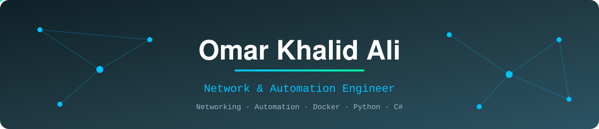

<!-- ===================== HEADER ===================== -->
<p align="center">
  
</p>

<p align="center">
  <a href="https://github.com/Omarnano11498">
    
  </a>
</p>

<p align="center">
  
  
  
</p>

---

### 👋 About me

```yaml
name:      Omar Khalid Ali
role:      Network & Automation Engineer
mindset:   "If I do it twice, I automate it."
focus:
  - Network infrastructure, monitoring & troubleshooting
  - IT automation (Python, PowerShell, Selenium)
  - Containerization & DevOps (Docker, Docker Compose)
  - Business desktop systems that kill spreadsheets chaos (C# / .NET)
currently:  Building tools that audit, monitor and secure IT environments
```

---

### 🌐 What I work on

| 🛰️ Networking | ⚙️ Automation | 🐳 DevOps & Infra | 🛡️ IT Security |
|:---|:---|:---|:---|
| LAN/WAN design & troubleshooting | Python & PowerShell scripting | Docker & Docker Compose | Health & security auditing |
| Routing, switching, VLANs | Browser automation (Selenium) | Reverse proxy setups | Cross-platform scanners |
| Network monitoring | Excel → automated workflows | Linux servers | Hardening & compliance checks |
| Windows Server / AD | Reporting & notifications | CI/CD with GitHub Actions | REST APIs for IT data |

---

### 🧰 Tech stack

<p align="center">
  
</p>

---

### 🚀 Featured projects

| Project | What it does | Stack |
|:---|:---|:---|
| 🛡️ [**Universal IT Health & Security Platform**](https://github.com/Omarnano11498/Universal-IT-Health-Security-Platform) | Cross-platform health & security auditing for **Windows, Linux and macOS** — read-only local scanner + REST API. | `Python` `REST API` |
| 🐳 [**Docker-Project**](https://github.com/Omarnano11498/Docker-Project) | Containerized architecture: separate backend & proxy images orchestrated with **Docker Compose**. | `Docker` `Compose` `Proxy` |
| 💬 [**PayrollWhatsApp**](https://github.com/Omarnano11498/PayrollWhatsApp) | Reads payroll from Excel and **automates** personalized WhatsApp Web messages via Selenium. | `C#` `.NET 8` `WPF` `Selenium` |
| 🧾 [**ERPChecks**](https://github.com/Omarnano11498/ERPChecks) | Desktop ERP for real-estate PDC cheques, cash inflows and delay penalties — **Clean Architecture**. | `C#` `WPF` `Clean Arch` |
| 🗂️ [**Csharp — HR Leave System**](https://github.com/Omarnano11498/Csharp) | Manages leave requests, exit permits and business missions with Excel as data store. | `C#` `.NET 10` `WinForms` |
| 📁 [**E-Archive**](https://github.com/Omarnano11498/E-Archive) | Electronic document archiving system. | `C#` |

---

### 📊 GitHub stats

<p align="center">
  
  
</p>

<p align="center">
  
</p>

<!-- Contribution snake — generated automatically by .github/workflows/snake.yml -->
<p align="center">
  <picture>
    <source media="(prefers-color-scheme: dark)" srcset="https://raw.githubusercontent.com/Omarnano11498/Omarnano11498/output/github-snake-dark.svg" />
    
  </picture>
</p>

---

### 🤝 Let's connect

<p align="center">
  <!-- Replace the placeholders below with your real links, or delete the badge you don't use -->
  <a href="https://www.linkedin.com/in/YOUR-LINKEDIN"></a>
  <a href="mailto:YOUR-EMAIL@example.com"></a>
  <a href="https://github.com/Omarnano11498"></a>
</p>

<p align="center"><i>Open to collaborations on network automation, IT monitoring and DevOps tooling.</i></p>
